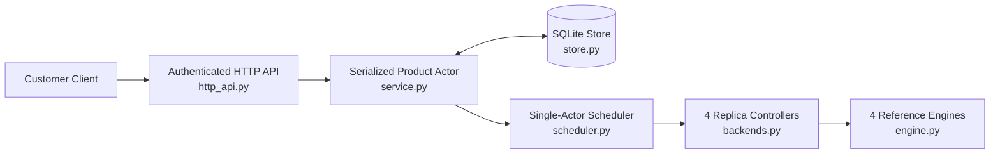

# Multi-LoRA Inference Serving

A zero-dependency Python 3.10+ multi-LoRA serving system. Customers register immutable adapter versions, promote them behind stable endpoints, and submit asynchronous inference. A single scheduler admits work against per-request deadlines, shares replicas fairly across customers, and places batches where adapters are already warm.

The compute path is a deterministic replica simulator (`engine.py`): four replicas, 32 adapter slots, batches of 1–128, and fixed batch time. The same scheduler runs on a discrete-event backend and on threaded engines.

- **Design:** [docs/design.md](docs/design.md)
- **Measurements:** [docs/iteration-report.md](docs/iteration-report.md)
- **Request flow:** [docs/illustrate.md](docs/illustrate.md)
- **Selected config:** [final_config.json](final_config.json) | **Eligibility comparison:** [results/final-eligibility.json](results/final-eligibility.json)

---

## 1. Quick Start

Run the full test suite and the end-to-end lifecycle demo (registration → promotion → inference → rollback → completion):

```bash
python3 -m unittest discover -v
python3 run.py demo --speed 20
```

### Running the Authenticated HTTP Server Locally

```bash
export KEY=$(python3 run.py provision --db serving.db --customer acme)
echo "Provisioned API Key: $KEY"
python3 run.py serve --db serving.db --port 8080 --config final_config.json
```

In another terminal (with `export KEY=...` set to the provisioned key above), every endpoint requires `Authorization: Bearer $KEY`:

```bash
# 1. Register an immutable LoRA version
curl -s http://127.0.0.1:8080/v1/loras/support/versions \
  -H "Authorization: Bearer $KEY" -H 'Content-Type: application/json' \
  -d '{"version":"v1","blob_path":"s3://example/support-v1"}'

# 2. Promote v1 to stable endpoint "support" (CAS on expected_revision)
curl -s http://127.0.0.1:8080/v1/endpoints/support/releases \
  -H "Authorization: Bearer $KEY" -H 'Content-Type: application/json' \
  -d '{"version":"v1","expected_revision":0,"release_id":"release-1"}'

# 3. Submit inference (models: "base", "lora:support@v1", or "endpoint:support")
curl -i http://127.0.0.1:8080/v1/inferences \
  -H "Authorization: Bearer $KEY" -H 'Content-Type: application/json' \
  -H 'Idempotency-Key: example-1' \
  -d '{"model":"endpoint:support","prompt":"Hello","input_tokens":1024,"max_output_tokens":500}'

# 4. Poll request status / result
curl -s http://127.0.0.1:8080/v1/requests/REQUEST_ID -H "Authorization: Bearer $KEY"
```

---

## 2. Core Concepts & Scheduling Prerequisites

Understanding five core mechanisms explains the entire scheduler (`scheduler.py`):

### Prerequisite 1: Engine Physics & The `Ticket` Abstraction

- **Engine Contract:** Each of the **4 replicas** holds **32 LoRA slots** (base model is always resident). A batch of **1 to 128 requests** targeting a single LoRA takes a flat `1.25s` (`BATCH_SECONDS`) and is **non-preemptible**. Loading a LoRA takes `2.0s` **(cold)** or `0.2s` **(warm, previously evicted to host RAM)** and can overlap an in-flight compute batch.
- **Batching Imperative:** At 128 requests/batch, fleet capacity is **409.6 req/s** (`102.4 req/s/replica`). At 1 request/batch, fleet capacity drops 128× to **3.2 req/s**.
- **In-Place** `Ticket` **Coalescing:** Requests for the same `(customer, lora, path)` coalesce in-place into an immutable `Ticket` (up to 128 requests) inside their assigned replica's `r.waiting` pool. A ticket's `deadline` is `min(req.deadline)` and `first_ingress` is `min(req.ingress)`. There is no separate per-customer queue; `Customer` only tracks fairness counters and timestamps.

### Prerequisite 2: Per-Replica EDF Ledger (`_reserve`) & Runtime Fallback (`_safe_first`)

Every accepted request has a hard deadline: `deadline = ingress + SLO` (`SLO = 900s`). Because all deadlines are shifted by a constant `+900s`, running strict EDF all the time is equivalent to strict FIFO—which causes severe batch fragmentation and starves small customers. Instead, we use **EDF as a feasibility envelope**:

1. **Conservative Admission Reservation (**`_reserve`**):**

   Each waiting ticket on a replica reserves worst-case execution time:

    where `load_upper_bound` is `0.0s` for `base`, `0.2s` **if warm** (ever loaded on that replica), and `2.0s` **if cold**. Even if an adapter is *currently resident* in GPU memory, waiting tickets still reserve `0.2s` so future cache evictions can never invalidate the admission ledger.
2. **Admission Check (**`_feasible`**):**

   A new request can join an existing ticket or create a new ticket on a replica only if sorting all waiting tickets on that replica by `(deadline, id)` satisfies `cumulative_reserved_work + response_margin <= ticket.deadline` for every prefix.
3. **Just-in-Time Dispatch Check (**`_safe_first`**):**

   When a replica becomes idle (`r.foreground is None`), our fairness/locality policy proposes a candidate ticket `first`. Before granting `first`, `_safe_first(r, first)` verifies that running `first` **now** (using its actual immediate load cost `_exposed_load`) followed by all remaining tickets on `r` in **EDF order** still meets every deadline. If safe, `first` runs immediately; if slack is exhausted, the replica falls back to its **EDF head** (`edf_overrides`).

### Prerequisite 3: Coalescing Window & Readiness Gate (`MAX_BATCH_WAIT = 30s`)

- Under the default `eligibility = "ready"` gate (`_batch_ready`), a waiting ticket enters normal fairness selection once it either **fills to 128 requests** or **ages to** `MAX_BATCH_WAIT = 30s` (or earlier if EDF slack runs out).
- **Why** `ready` **beats** `pending`**:** Because batches are non-preemptible and cost a flat `1.25s`, allowing a 1-request young arrival (`eligibility = "pending"`) to immediately win customer fairness locks up a replica for `1.25s–3.25s` and burns the customer's fairness credit. Full-trace experiments (`results/final-eligibility.json`) show the `ready` gate completes more requests and lowers the smallest customer's max wait (`71.5s–80.4s` vs `94.4s–124.5s`).

### Prerequisite 4: Customer-First Fairness (`60s Gap Guard` + `Virtual Service`)

Across all idle replicas and legal ready tickets, dispatch selects the **customer first** (`_choose`):

1. **Starvation Guard (**`starvation_threshold = 60s`**):**
   ```text
    service_gap(c) = now - max(backlog_since(c), last_grant(c))
   ```

    If any eligible customer has waited `>= 60s` with unstarted work since its last foreground grant, pick the customer with the largest `service_gap`. (This is a priority trigger at legal dispatch opportunities, not an unconditional hard wait bound.)
2. **Virtual Service (WFQ):**

   Otherwise, pick the customer with the minimum accumulated `virtual_service`. When a foreground grant commits, the scheduler **immediately reserves** `(1.25 + exposed_load) / weight` before the next idle replica chooses (preventing 4 idle replicas from simultaneously granting the same customer), and reconciles to actual service on completion. Newly active customers join at `min(active virtual_service)`.

### Prerequisite 5: Unified Efficiency Score (`_pair_cost`) & Demand-Aware LRU

Under the selected `locality` policy, **both** Admission (choosing which feasible replica a new ticket lands on) and Within-Customer Dispatch (choosing which `(ticket, replica)` of the selected customer to run first) rank candidates using the exact same amortized cost function:

```text
pair_cost(ticket, r) = (wait(r) + exposed_load(ticket, r) + 1.25) / len(ticket.requests)
```

- `exposed_load(ticket, r)`**:** `0.0s` if `base` or currently in `r.resident`; remaining loader time if already loading; `0.2s` if in `r.warm`; `2.0s` if cold.
- `wait(r)` **(Backlog / Congestion Proxy):** Remaining compute on `r` plus `r.reserved_total` of other waiting tickets on `r`.
  - *At Admission:* steers new tickets toward replicas where the adapter is already resident/warm, while spilling to another replica if the home replica is heavily backlogged.
  - *At Dispatch:* even though the chosen ticket executes **first** on idle replica `r`, keeping `wait(r)` in the numerator acts as an opportunity-cost penalty—preferring lightly backlogged replicas and strongly favoring larger batches on heavily backlogged replicas.
- **Within-Customer Cold Tickets:** If a customer has both hot full batches and a cold small ticket, `_pair_cost` prioritizes the hot full batches for efficiency while `_safe_first` (EDF) guarantees the cold ticket is flushed before its 900s deadline can be missed.
- **Demand-Aware LRU (**`_victim`**):** When all 32 slots on a replica are full, eviction never touches `loading` or `in-use` adapters, prefers evicting resident adapters that have **no waiting tickets on that replica** (`lora not in queued`), and breaks ties by oldest `last_use`.

---

## 3. Architecture



| File | Responsibility |
| :--- | :--- |
| `engine.py` | Replica simulator (`BATCH_SECONDS=1.25`, `COLD=2.0`, `WARM=0.2`, 32 slots, max batch 128). |
| `scheduler.py` | Tickets, per-replica EDF admission/fallback, customer gap guard + virtual service, `_pair_cost`, demand-aware LRU. |
| `backends.py` | `VirtualBackend` (deterministic discrete-event simulator) and `ThreadedBackend` (threads wrapping `InferenceEngine`). |
| `store.py` | SQLite (`WAL`, `synchronous=FULL`) for API keys, immutable LoRA versions, CAS endpoint routes, and durable requests. |
| `service.py` | Serialized product coordinator: auth, route pinning, durable-before-`202` admission, attempt fencing, crash recovery. |
| `http_api.py` | Standard-library `ThreadingHTTPServer` exposing JSON endpoints. |
| `benchmark.py` / `audit.py` | Trace runner and independent event/request conservation verifier (imports neither `scheduler` nor `backends`). |

### Registration, sharing, and the request path

1. **Registration and routing**
   - Customers authenticate with `Authorization: Bearer <API_KEY>`.
   - `POST /v1/loras/{name}/versions` registers an immutable `(customer, name, version) -> blob_path` record (re-registering the same version with a different path returns `409`).
   - `POST /v1/endpoints/{name}/releases` atomically updates a stable endpoint route using `expected_revision` (CAS) and an idempotent `release_id`.
   - `POST /v1/inferences` accepts `"base"`, explicit `"lora:<name>@<version>"`, or stable `"endpoint:<name>"`. Resolution pins `(customer, name, version, blob_path)` at admission so subsequent promotions/rollbacks never alter in-flight requests.
2. **One customer on an idle fleet**
   - **Yes, when no other customer is eligible.** Virtual service is work-conserving across eligible customers: a single active customer can receive grants on all 4 replicas simultaneously. When other customers become ready, virtual service and the 60s gap guard reclaim fair share immediately. Per-tenant memory caps (`tenant_ticket_cap = 32` unstarted tickets, `32 MiB` prompt bytes) bound queued memory, not active compute share.
3. **Control plane**
   - A single-actor control plane (`ProductService` + `Scheduler`) backed by SQLite and 4 replica controllers (each managing 1 foreground compute slot and 1 background loader slot per `InferenceEngine`). For a fixed 4-replica fleet, centralized single-actor scheduling avoids distributed lock/state drift while taking only ~15–25s of CPU across 780,000 requests.
4. **Admission sequence**
   1. Capture ingress timestamp and authenticate the Bearer API key (`401` if invalid).
   2. Validate JSON body and declared tokens (`input_tokens + max_output_tokens <= 32768`, `400/413/422` if invalid).
   3. Check customer-scoped `Idempotency-Key` (returns existing request if matched, `409` if payload changed).
   4. Resolve model/endpoint to an immutable `(customer, name, version)` and `blob_path` (`404` if unowned/missing).
   5. Check tenant caps (`32` waiting tickets / `32 MiB`) and per-replica EDF feasibility (`429` if rejected; `503` if no healthy replica).
   6. Persist the accepted request to SQLite (`synchronous=FULL`) **before** returning `202 Accepted` with `Location: /v1/requests/{id}` (if SQLite commit fails, cancel the unstarted ticket reservation).
   7. Coalesce in `r.waiting`, dispatch via `tick()`, reconcile virtual service on completion, persist terminal outcome, and serve via `GET /v1/requests/{id}`.
5. **Failures**
   - The matrix under [Failure behavior](#failure-behavior) lists status codes and recovery.

---

## 4. Measurements

All benchmarks use **seed 17** and saved traces under `results/traces/` with 50 customers, 200 LoRAs (1–10 per customer), 4 replicas, largest customer `c00` at **40% of traffic**, smallest customer `c49` at **0.02% (~3 req/min steady)**, and arrival rates **250 req/s steady (120s) → 1,000 req/s burst (600s) → 250 req/s recovery (600s)** (780,000 total requests, `SLO = 900s`).

- **Pattern 1 (**`80%-hot` **/** `p80`**):** 10 hot LoRAs take 80% of requests; 190 tail LoRAs take 20%.
- **Pattern 2 (**`50%-hot` **/** `p50`**):** 10 hot LoRAs take 50% of requests; 190 tail LoRAs take 50%.

### Skew that starves a customer

1. **Under Naive FIFO:** High-rate arrivals interleaved across many adapters prevent contiguous batching and fill the queue with old tickets from heavy senders. Sparse customers wait behind hundreds of fragmented batches (`max_service_gap` reaches **420s–580s**, and smallest customer `c49` has >94% of requests rejected).
2. **Under Pure Throughput / Locality Greedy (without Customer Fairness):** If dispatch ranked all tickets globally by `_pair_cost`, whale customer `c00` (with 128-request resident batches costing `~0.01s/req`) would perpetually beat `c49` (1-request cold batch costing `3.25s/req`), starving `c49` until its 900s EDF deadline forced an override.
3. **Under Per-LoRA Aging (without Customer Accounting):** Giving each adapter an independent starvation timer lets a customer with 10 cold adapters claim 10× the priority overrides of a customer with 1 adapter.

- **How our design prevents this:** Fairness and the 60s starvation trigger operate strictly at the **customer account level**, bounding fleet max customer service gap to **~63–65s** across both patterns while per-request EDF guarantees no accepted cold adapter misses its 900s deadline.

### Capacity versus observed goodput

- **Theoretical Ceiling:** `128 requests / 1.25s = 102.4 req/s/replica` (**409.6 req/s fleet-wide**).
- **Observed Full-Batch Saturation Rate:**
  - *Engine-only barrier benchmark (4 threads, 64 full base batches/replica,* `SIM_SPEED=10`*):* **395.04 req/s fleet-wide** (`96.45%` of theoretical).
  - *Full Scheduler + ThreadedBackend saturation (*`results/calibration/base-saturation-final.json`*, 32,768 requests,* `speed=5`*):* **393.14 req/s fleet-wide** (`98.29 req/s/replica`, `95.98%` of theoretical), with 0 deadline or timing violations.
- **Why they differ:** The ~4% gap on full base batches comes from thread-pool dispatch, lock acquisition, event logging, and OS sleep/wakeup jitter (`time.sleep` overshoot amplified by `SIM_SPEED`). On skewed multi-LoRA workloads, observed burst deadline goodput is **~134–141 req/s** because (a) long-tail adapters often dispatch as partial batches after the 30s window (`mean batch size ~55` vs `128`), and (b) cold (`2.0s`) and warm (`0.2s`) adapter loads consume foreground time when not fully hidden behind compute.

### Uneven customer demand

- In our traces, `c00` sends **40% of all traffic** (312,000 offered requests) while `c49` sends **0.02%** (166 offered requests).
- **When the fleet is idle:** `c00` can borrow all 4 replicas.
- **During the 1,000 req/s overload:** Equal customer virtual service (`weight = 1.0`), the 60s customer gap guard, and the per-customer `32-ticket` cap isolate other tenants from `c00`:
  - Smallest customer `c49` has **166 / 166 (100%)** of its requests accepted and completed on time (max wait `71.5s–93.7s`).
  - Whale customer `c00` is prevented from monopolizing the queues and experiences **~96% rejection** (`tenant_limit`) during sustained overload, while still receiving full-batch service on its accepted tickets.

### Scheduler comparison — `FIFO` vs. `Fair` vs. `Fair + Locality`

Full 780,000-request traces (`120s steady / 600s burst / 600s recovery + drain`, `max_batch_wait=30s`, `starvation_threshold=60s`, `controller/response_margin=1.5s`). Values are reported as `80%-hot (p80) / 50%-hot (p50)`:

#### Deterministic Virtual Backend (`results/final-virtual/*.json`)

| Policy | Accepted = Completed | Rejected | Mean Batch Size | Burst Goodput (req/s) | Max Customer Gap (s) | Smallest Customer (`c49`) Accepted | Smallest Customer Max Wait (s) | Warm Reloads |
| :--- | ---: | ---: | ---: | ---: | ---: | ---: | ---: | ---: |
| **FIFO + EDF Guard** | 14,884 / 9,560 | 98.09% / 98.77% | 3.37 / 2.20 | 7.38 / 4.73 | 420.53 / 435.52 | 8 / 7 (of 166) | 422.40 / 435.52 | 1,977 / 2,022 |
| **Fair** | 186,225 / 180,121 | 76.12% / 76.91% | 54.80 / 54.12 | 126.31 / 123.31 | 64.48 / 63.48 | **166 / 166** | **71.52 / 80.39** | 2,063 / 2,089 |
| **Fair + Locality (Selected)** | **192,528 / 184,592** | **75.32% / 76.33%** | **55.29 / 54.47** | **139.16 / 134.17** | **63.81 / 64.79** | **166 / 166** | 93.67 / 91.22 | **1,232 / 1,233** |

#### Original Threaded Engine Backend at `speed=5` (`results/final-original/*.json`)

| Policy | Accepted = Completed | Burst Goodput (req/s) | Max Customer Gap (s) | Smallest Customer (`c49`) Accepted | Smallest Customer Max Wait (s) |
| :--- | ---: | ---: | ---: | ---: | ---: |
| **FIFO + EDF Guard** | 15,341 / 7,716 | 7.46 / 1.60 | 437.80 / 579.83 | 9 / 4 (of 166) | 635.33 / 585.04 |
| **Fair** | 181,419 / 177,705 | 118.59 / 124.08 | 65.20 / 64.33 | **166 / 166** | 60.33 / 70.22 |
| **Fair + Locality** | **191,461 / 180,793** | **140.85 / 125.13** | **64.98 / 63.24** | **166 / 166** | 57.30 / 84.55 |

- **Zero SLO Violations:** Across all 12 full runs above, **accepted = completed**, with **0 failed requests, 0 deadline misses (**`>900s`**), 0 stranded requests, and 0 engine-contract audit errors**. (Note: 5 of 6 original-engine runs experienced host OS paging pauses exceeding the 1.5s margin; see `docs/iteration-report.md` §8 for timing-bound diagnostics.)

### Summary of the 5 Core Design Tradeoffs

| #     | Design Dimension                           | Options Considered                                                                                                                                                                                                                                                | Measured Tradeoff & Evidence                                                                                                                                                                                                                                                                                                                                                                                                                                                                                       | Selected Decision (`final_config.json`)                                                                                            |
| :---- | :----------------------------------------- | :---------------------------------------------------------------------------------------------------------------------------------------------------------------------------------------------------------------------------------------------------------------- | :----------------------------------------------------------------------------------------------------------------------------------------------------------------------------------------------------------------------------------------------------------------------------------------------------------------------------------------------------------------------------------------------------------------------------------------------------------------------------------------------------------------- | :--------------------------------------------------------------------------------------------------------------------------------- |
| **1** | **Admission Control**                      | 1. **Coarse Bound** (sum of all work ≤ earliest deadline) 2. **Per-Replica EDF** (`_feasible` + `_safe_first` fallback) 3. **Global Schedule Replay** (simulate all 4 replicas + caches on every arrival)                                                         | *Coarse Bound* falsely rejects staggered deadlines (e.g., two `1.45s` warm tickets due at `2s` and `10s` fail `2.90s <= 2s`). *Global Replay* costs `O(backlog)` simulation per arrival and breaks when the next arrival alters cache/fairness order. *Per-Replica EDF* runs in `O(N log N)` (with `O(1)` `certified_until` coalescing cache) and achieved **0 deadline misses across 754k+ accepted requests**.                                                                                                   | **Per-Replica EDF +** `_safe_first` **Runtime Fallback**                                                                           |
| **2** | **Batching Window (**`MAX_BATCH_WAIT`**)** | `0s` **vs.** `30s` **vs.** `60s` **vs.** `120s` (with fixed 60s starvation guard)                                                                                                                                                                                 | Screen runs (`docs/iteration-report.md` §9) show completions of `39.6k / 43.6k / 47.4k / 53.3k` (`p80`), but max customer service gaps rise from `61s` **(**`0s`**) and** `64s` **(**`30s`**)** to `87s` **(**`60s`**) and** `143s` **(**`120s`**)**. Full traces (§5) confirm `60s` adds only ~4–5% completions while pushing gaps to `94s`.                                                                                                                                                                      | `max_batch_wait = 30s` (throughput vs. starvation knee point)                                                                      |
| **3** | **Eligibility Rule**                       | `ready` **gate** (128 reqs or age ≥ `30s`) vs. `pending` (1-req young ticket competes immediately)                                                                                                                                                                | Because batches are non-preemptible (`1.25s` flat), `pending` lets a 1-request arrival from a low-service customer lock up a replica for `1.25s–3.25s`. On full traces (`results/final-eligibility.json`), `ready` completes **+1.1k to +2.7k more requests** and lowers `c49` max wait (`71.5s–80.4s` vs. `94.4s–124.5s`).                                                                                                                                                                                        | `eligibility = "ready"` (`pending` kept selectable)                                                                                |
| **4** | **Core Scheduling Policy**                 | `FIFO` vs. `Fair` (queue-balance + plain LRU) vs. `Locality` (`_pair_cost` + Demand LRU)                                                                                                                                                                          | `Fair` beats `FIFO` by **12.5×–19×** (`186k` vs `14.8k` completed) and accepts **100%** of `c49`. Adding `Locality` cuts warm reloads by **~40%** (`2,063 -> 1,232`) and completes **+6,303 (**`p80`**) / +4,471 (**`p50`**)** more requests, trading a modest increase in cold-adapter tail wait (`c49` max wait `71.5s -> 93.7s`, well inside `900s` SLO).                                                                                                                                                       | `policy = "locality"` (`Fair` retained as simpler fallback)                                                                        |
| **5** | **Incremental Locality Mechanisms**        | 1. `joint` (`_pair_cost` placement/dispatch) 2. `demand` (Demand-aware LRU) 3. `slru` (2nd-hit cache) 4. `prefetch` (background load) 5. `replication` (full-batch migration) 6. `marginal` (drop `wait` at dispatch) 7. `opportunistic` (early partial dispatch) | • `joint` **+** `demand`**:** Cut warm reloads in half (`2,312 -> 1,150`) and added `+7.7k` completions with minimal CPU (`15.5s`). • `prefetch` **&** `replication`**:** On 780k traces (§4), a `2.0s` cold prefetch overruns a `1.25s` batch and blocks the single loader, pushing `p50` max gap from `94.6s` to `118.4s` **/** `113.4s` and spiking scheduler CPU **4×–5× (**`15.5s -> 64s–87.7s`**)** for ~2% gain. • `slru` **&** `marginal`**:** Changed screen completions by `0%` and `<0.07%` (+37 reqs). | **Keep** `joint` **+** `demand` **ON; keep** `prefetch` **&** `replication` **OFF (**`false`**); deleted** `slru` **&** `marginal` |

### Failure behavior

| Failure Mode | System Behavior | What the User Sees |
| :--- | :--- | :--- |
| **Invalid / missing API key** | Rejects before parsing route or body. | `401 Unauthorized` (`WWW-Authenticate: Bearer`). |
| **Unowned / unknown LoRA or endpoint** | Rejects during scoped metadata lookup. | `404 Not Found`. |
| **Malformed JSON / >1 MiB body / >32K tokens** | Rejects at input validation. | `400 Bad Request` / `413` / `422 Unprocessable Entity`. |
| **Immutable version conflict / stale release revision / changed idempotent payload** | SQLite transaction aborts on conflict or CAS mismatch. | `409 Conflict` with specific reason. |
| **Overload / infeasible deadline / tenant cap (32 tickets or 32 MiB)** | Rejected at admission before persisting; existing commitments untouched. | `429 Too Many Requests` (`conservative_capacity`, `deadline_infeasible`, or `tenant_limit`). |
| **Engine load/compute error** | Increments attempt fence (`token`), reconciles virtual service, and retries at most once (`max_retries=1`) on a feasible replica within the **original** deadline. Stale callbacks from old tokens are ignored. | `202` initially; polling `GET /v1/requests/{id}` returns `completed` if retry succeeds, or `status: "failed"` (`slo_violation: true`) if retry is infeasible/fails. |
| **Replica timing-bound overrun (hung worker)** | `_timing_healthy(r)` marks replica unhealthy and stops admitting new tickets to it until the operation finishes. | `503 Service Unavailable` (`no_healthy_replica`) if all replicas are unhealthy. |
| **SQLite failure during admission** | `scheduler.cancel(id)` rolls back the in-memory ticket reservation under the same actor lock before any dispatch. | `503 Service Unavailable` (`durable acceptance unavailable`); no ghost execution. |
| **Process crash & restart** | `ProductService.recover()` advances logical clock anchor, increments `attempt` generation in SQLite, resets replica cache warmth to cold, and re-admits unfinished requests against their **original** deadlines. | Polling returns `running`/`queued` if still feasible, or `status: "failed"` (`error: "recovery_..."`, `slo_violation: true`) if downtime exhausted the deadline. |

---

## 5. Production scope

Full architectural details are in [§5 of the Design Spec](docs/design.md#5-long-tail-deep-dive):

- **Long-Tail Serving & Physical GPU Sizing (§5.1–5.2):** Implemented warm-aware placement (`_pair_cost`), demand-aware LRU (`_victim`), and optional bounded prefetch/replication switches. For the 3T base model in BF16, weight-only lower bounds are **6 TB/replica** for the base model and up to **60 GB/adapter** (1% of 3T), meaning 32 max-size adapters require **1.92 TB** across tensor-parallel ranks. Production should use a local `GPU HBM <- pinned host RAM <- local NVMe <- Blob Store` hierarchy before adding peer-to-peer transfers.
- **Customer Release Lifecycle (§5.4):** Implemented explicit immutable versions (`lora:name@v1`) and CAS endpoint promotion/rollback (`POST /v1/endpoints/{name}/releases`) with request-level version pinning. Automated canary pipelines are documented as a design extension.
- **Priority Tiers (§5.3, Design Extension):** Strict `Pro > Standard` priority at dispatch with cross-tier conservative capacity reservation at admission (preventing new Pro arrivals from violating already-accepted Standard deadlines, while disclosing Standard admission starvation under Pro bursts).

---

## 6. Reproducing Measurements & Independent Audits

```bash
# Generate deterministic seed-17 traces
python3 run.py trace --stage screen --pattern 80 --output /tmp/screen.jsonl.gz

# Run screening, full virtual, original-engine, and identical-cohort replay suites
python3 scripts/screen.py batching
python3 scripts/screen.py locality --wait 60
python3 scripts/validate.py locality
python3 scripts/validate.py final-virtual
python3 scripts/validate.py final-original --speed 5
python3 scripts/validate.py replay

# Summarize cards and run independent raw-event/request conservation audits
python3 run.py report results/final-virtual/*.json results/final-original/*.json
python3 run.py audit results/final-virtual/*.json results/final-original/*.json

# Archive source, configs, and result cards
python3 run.py package --output dist/multi-lora-serving.zip
```
