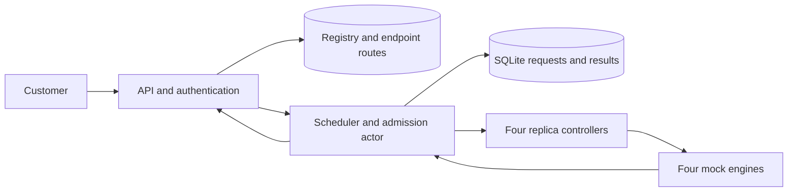

# Multi LoRA Inference System Design

**Status:** Serving stack with authenticated SQLite-backed APIs and one scheduler, used by both a deterministic virtual backend and threaded replica engines. Measured defaults and limits are in the [README](../README.md) and the [measurement report](iteration-report.md).
**Primary target:** Long-tail LoRA serving. Priority tiers and automated customer CI/CD are design-only extensions; registration and manual release/rollback are implemented.

**Recommendation:** optimize throughput inside a fair customer scheduler, protect customers that receive no service, and use admission plus an EDF dispatch guard to preserve every accepted request's deadline. Adapter age remains request metadata and a diagnostic, without a separate per-LoRA priority entitlement. This document is the design reference.

## 1 Operating assumptions

Engine contract: [README](../README.md), [engine.py](../engine.py), and [test_engine.py](../test_engine.py).

| Constraint | Design response |
| --- | --- |
| Objectives | Minimize **per-customer starvation** and maximize completed throughput. Measure customer progress, acceptance, and failures together. |
| Population and skew | About 50 customers, 200 LoRAs, 1–10/customer. Ten hot LoRAs receive 80% or 50% of requests; largest customer sends about 40%, smallest a few requests/minute. Preserve ownership and these marginals jointly. |
| Traffic and fleet | 250 requests/s steady, bursts to 1,000 requests/s for up to 600 seconds; exactly four replicas, with no autoscaling. |
| Engine | Each replica has 32 resident/loading adapter slots, one nonpreemptible batch of 1–128 requests for one adapter, and fixed 1.25s compute regardless of fill. Cold/warm loads cost 2.0/0.2s per replica and may overlap compute. Base is always resident. |
| Accepted-request deadline | Every accepted request must complete successfully, with its result available, within configurable `SLO = 900s` of ingress. Admission protects previous commitments. A terminal error or lost accepted request counts as a violation, even if reported early. |
| Request and model shape | Context ≤32,768 input plus requested maximum output tokens; averages about 1K input/500 output. The mock uses declared token counts and fixed compute; production needs the pinned tokenizer. Base has 3T parameters, adapters ≤1% of that. |
| Product interface | API-key authentication on every operation; owned registered LoRAs or base; registration maps customer/name/version to an existing blob path. Upload/cloud-auth plumbing and streaming are outside scope. Manual release/rollback sits behind a stable endpoint. |
| Runtime | Python 3.10+, standard library, Linux/macOS on x86/aarch64. |

The service implements the product API and local long-tail policies. Physical GPU and distribution details are designs, not extra storage services. Deadline enforcement assumes healthy workers and bounded engine/controller timing; faults stay visible violations.

## 2 Architecture



One actor owns accepted batch tickets, customer service accounts, deadlines, and dispatch. Each replica has a foreground worker and one loader; a foreground grant commits its next load/compute sequence. Controllers own residency and bounded pins. SQLite persists registry/routes, idempotency, accepted requests, and results; no transaction spans an engine sleep. Distributed scheduling adds coordination without a clear benefit for four replicas.

| API | Success | Request / Response Contract & Behavior |
| --- | --- | --- |
| `POST /v1/loras/{name}/versions` | `201 Created` | **Req:** `{"version": "v1", "blob_path": "s3://..."}`<br>**Res:** `{"name": "support", "version": "v1", "blob_path": "s3://..."}`<br>Derives `customer` from `Authorization: Bearer <key>`. Idempotent on identical `(version, blob_path)`; returns `409` if `blob_path` differs. |
| `POST /v1/endpoints/{name}/releases` | `200 OK` | **Req:** `{"lora_name": "support", "version": "v1", "expected_revision": 0, "release_id": "rel-1"}` (`lora_name` defaults to `{name}`)<br>**Res:** `{"endpoint": "support", "lora_name": "support", "version": "v1", "revision": 1, "release_id": "rel-1"}`<br>Atomically promotes or rolls back the route via CAS on `expected_revision` (`409` on revision mismatch or `release_id` payload conflict; `404` if version is unregistered). |
| `POST /v1/inferences` | `202 Accepted` | **Headers:** `Authorization: Bearer <key>`, optional `Idempotency-Key: <1..256 chars>`<br>**Req:** `{"model": "base" \| "lora:name@v1" \| "endpoint:name", "prompt": "...", "input_tokens": 1024, "max_output_tokens": 500, "idempotency_key": "..."}` (`input_tokens + max_output_tokens <= 32768`, body `<= 1 MiB`)<br>**Res:** `Location: /v1/requests/{id}` header + request status object (`status: "queued"`). Returns `202` only after SQLite `synchronous=FULL` commit succeeds. |
| `GET /v1/requests/{id}` | `200 OK` | **Res:** `{"id": "...", "status": "queued" \| "running" \| "completed" \| "failed", "resolved_model": "lora:support@v1", "ingress": 10.0, "deadline": 910.0, "attempt": 1, "started_at": 12.0, "completed_at": 13.25, "result": {"id": "...", "lora": "...", "output": "..."}, "error": null, "slo_violation": false}`<br>Scoped to the authenticated customer (`404` if unknown or owned by another tenant). |

| Status Code | Error Contract (`{"error": "<reason>"}`) |
| --- | --- |
| `400` / `413` / `422` | Malformed JSON or invalid `Content-Length` (`400`), body `> 1 MiB` (`413`), invalid identifiers, unknown fields, or `input_tokens + max_output_tokens > 32768` (`422`). |
| `401 Unauthorized` | Missing or invalid Bearer API key (includes `WWW-Authenticate: Bearer` header). |
| `404 Not Found` | Unknown route, or LoRA version / endpoint / request ID does not exist or belongs to another customer. |
| `409 Conflict` | Immutable version path conflict, stale `expected_revision` on release, or reused `Idempotency-Key` / `release_id` with a different payload. |
| `429 Too Many Requests` | Admission rejected: `tenant_limit` (`>32` waiting tickets or `>32 MiB` queued prompt bytes), `deadline_infeasible`, or `conservative_capacity` (per-replica EDF check failed). |
| `503 Service Unavailable` | `no_healthy_replica` (all replicas exceeded timing bounds), `scheduler worker is unavailable`, or `durable storage unavailable` (SQLite error; unstarted reservation is rolled back). |

Use `(customer_id, lora_name, version) -> blob_path` for registry, batch/cache identity, and unique engine naming. A registered path stays fixed; new weights require a new version because loading an already-loaded engine name is a no-op. Different versions never batch together. Endpoint resolution pins version/path at acceptance, through retries and later releases. Base consumes no adapter slot but participates in fairness.

Retry within the original deadline, fence stale attempts, and publish one terminal result. On restart/replacement, recover durable requests, reset replica warmth, and revalidate remaining work; report unrecovered accepted failures.

## 3 Scheduler

### 3.1 Customer selection and starvation protection

**Use customer virtual service plus a customer service-gap guard.** A customer's adapters and API keys share one account. Queue age alone is a poor customer-starvation signal: a high-volume customer can have old requests while receiving continuous service. Conversely, per-LoRA overrides can give a customer with ten old adapters repeated priority over one with a single adapter.

```text
ready (default): eligible = customers with a full or MAX_BATCH_WAIT-aged ticket and a legal available worker/move
pending:         eligible = customers with any legal pending ticket, including one young request
if any eligible customer's service_gap >= CUSTOMER_STARVATION_THRESHOLD:
    choose the customer with the largest service_gap
else:
    choose the customer with the least virtual service
under pending, within that customer prefer a full or aged ticket when one exists;
otherwise dispatch its best legal young partial
apply the deadline safety guard before committing
```

While queued work remains, `service_gap = now - max(backlog_started_at, last_foreground_grant_at)`. A grant starts an actual committed load/compute sequence; prefetch, acceptance, and merely choosing a candidate do not reset the gap. After a grant, that customer competes normally again, regardless of how many adapters remain old. Temporarily blocked customers retain their gap while other workers serve legal work.

Default eligibility is **`ready`**. A small young ticket does not make its customer ready; the customer joins virtual service and the 60s guard only with a full (128) or `MAX_BATCH_WAIT`-aged ticket and a legal available worker or permitted safe move. The full-trace comparison in `results/final-eligibility.json` shows this gate completes more requests and gives the smallest customer a shorter maximum wait than `pending`, which marks that small ticket as a ready customer. `pending` remains implemented: after the customer is chosen, a full or aged ticket is still preferred, and a young partial runs only when the customer has no ready ticket. A physically blocked customer cannot prevent another customer's legal grant. Any optional move must preserve source and destination deadline commitments before it creates an eligible pair.

Reserve estimated virtual cost at grant time, then reconcile to actual `(batch_seconds + exposed_blocking_load_seconds) / customer_weight`; this prevents four simultaneous workers from spending the same uncharged fairness credit. Default weights are equal. Base traffic uses per-customer tickets, so each batch has one service account. A truly empty customer rejoins at the active virtual minimum. One customer may borrow the entire idle fleet; a configurable queued-byte cap and initial 32 unstarted tickets/customer bound memory, not its running share. Report tenant-limit rejection separately.

Fix **`CUSTOMER_STARVATION_THRESHOLD = 60s`**, independently of `MAX_BATCH_WAIT`. Virtual service and this guard are both part of the default Fair scheduler; no ON/OFF ablation or threshold sweep is planned. Validate each timer independently within the SLO and scale clocks consistently. The guard is a **scheduling priority trigger at legal opportunities**, not an unconditional latency guarantee. Under the default ready gate it applies to customers whose ticket is already full or aged. EDF may override the preferred dispatch to preserve accepted deadlines. Report actual gaps between batch starts as well as request wait.

The fixed Fair default combines virtual service and the 60s customer service-gap guard. Per-LoRA age remains diagnostic; it grants no separate adapter entitlement. No additional protection ablation is needed.

A cold LoRA may wait while another adapter of its customer runs. Its **original request deadlines remain in every feasibility check**. Before another preferred batch could cause a miss, EDF takes over. Removing adapter priority therefore changes normal ordering without relaxing either customer service accounting or accepted-request deadlines. Keep per-LoRA wait diagnostics to expose this tradeoff.

### 3.2 Joint LoRA and replica selection

After customer selection, compare its legal `(LoRA, replica)` pairs. Under `pending`, prefer full or timed-out tickets within that customer when any exist; otherwise dispatch a legal young partial. Under the default `ready` gate those candidates are already full or aged. Preserve the simple control score:

```text
estimated_replica_wait = remaining_current_compute + other_committed_ticket_work
pair_cost = (estimated_replica_wait + exposed_load + 1.25) / batch_size
```

Use one snapshot/helper for placement, prefetch, and control dispatch. Remaining compute is `max(0, 1.25 - elapsed)`, zero when idle. Other work sums stored reservations for **all other accepted, compute-unstarted tickets on that replica**, including other customers and loading tickets; exclude the candidate and running batch. Candidate load is zero for base/resident, remaining time if already loading, otherwise cold 2.0s or warm 0.2s. Do not independently add other loaders' wait again. This is a backlog proxy, not a start-time prediction or an instruction to drain the queue first.

For example, 0.75s remaining compute plus two other 1.45s reservations gives 3.65s estimated wait. An idle worker may still dispatch the selected ticket before those other tickets. Foreground loading tickets stay in this scoring proxy until compute starts; admission instead puts their remaining sequence in `I_r` (§4), without double-counting it in its waiting queue.

Break score ties by oldest ingress, exposed load, and stable IDs. Demand loading starts once a foreground grant commits the candidate; do not keep rescoring it away. Busy workers are placement/prefetch candidates; use other available workers rather than waiting solely for a preferred home. Migration atomically checks both ledgers. Cold loading is eventually needed somewhere for accepted cold work, but its timing, overlap, and replica choice still affect throughput.

The production implementation retains this one backlog/load proxy. Screening compared marginal dispatch and a second-hit cache preference; the benefits were small or absent, so their branches and configuration fields were removed. Comparison cards remain under `results/`. A victim-reload dispatch penalty was not promoted: demand-aware eviction and overlap are simpler ways to address observed reload cost. History does not multiply admission reservations or per-request service cost.

### 3.3 Batching window

Full (128) or `MAX_BATCH_WAIT`-aged tickets are the default eligibility gate. New arrivals never extend the first member's timer. A single young request waits until the ticket fills or ages, unless its deadline forces an EDF dispatch. `pending` can still dispatch that young request when it wins selection. The measured default is the ready gate because treating the small ticket as a ready customer reduces acceptance and lengthens the smallest customer's maximum wait.

**Staged selection:** screen batching windows **0, 30, 60, and 120 seconds**, as representative comparisons, with seed 17 and one run per configuration/trace. Do not exhaustively tune the window; expand beyond these four only when results reveal a meaningful reason. Use the 30s steady / 60s burst / 60s recovery traces only for screening. Promote promising windows to 120s / 600s / 600s traces, retaining the original 900s deadline, then drain accepted work. The final configuration and measured tradeoffs live in the iteration report.

Wake on arrivals, engine completions, and batching timers. EDF slack still protects commitments when dispatch is legally blocked. A customer-gap timer cannot create a legal opportunity on a busy replica. `MAX_BATCH_WAIT` is neither a promised start time nor, under `pending`, a minimum delay. The combined full-trace result is `results/final-eligibility.json`; the ready gate is the default.

## 4 Admission

**Recommend per-replica EDF feasibility plus the same check at dispatch.** Every accepted request keeps `deadline = ingress + SLO`; each ticket uses its earliest member deadline. Each waiting ticket reserves `C = 1.25 + load_upper_bound + controller_margin`: zero load for base, 0.2s for previously loaded versions on that replica, otherwise 2.0s. Resident adapters retain the reload allowance so eviction cannot invalidate the check. No future-arrival fill or speculative overlap is assumed.

Let `I_r` bound current foreground load/compute plus any unrelated active loader blocking. Exclude that foreground ticket from the waiting list; check its own completion too. Use remaining compute rather than charging another full batch. For each tentative join/new ticket on a candidate replica:

```text
t = now + I_r
for ticket in waiting_tickets sorted by (earliest_deadline, id):
    t += ticket.reserved_work_seconds
    reject this placement if t + response_margin > ticket.earliest_deadline
accept a placement only if all earlier commitments also remain feasible
```

Try eligible joins/placements across four replicas before rejecting, then commit through the actor and persist before returning 202. Foreground commitment freezes membership. Migration/retry/replacement updates cost and rechecks affected ledgers without extending deadlines. A failed necessary lower bound means `deadline_infeasible`; failure of this sufficient EDF bound means `conservative_capacity`, not proof no schedule exists. Tenant caps are a separate rejection reason.

**Runtime agreement is essential:** check the preferred batch first, followed by the remaining tickets in EDF order. If unsafe, run that replica's EDF head, even if partial, cold, or owned by another customer. Check intentional idle time and added prefetch blocking using the same helper, and wake before slack runs out. This retains a feasible fallback while permitting throughput-oriented choices with slack. EDF failure after an accepted fault requires recovery or an explicit counted failure, not silently dropping the commitment.

| Admission option | Benefit | Cost / limitation | Decision |
| --- | --- | --- | --- |
| Conservative workload bound: all queued work before the earliest deadline | Tiny; tolerates arbitrary reordering. | Rejects feasible staggered-deadline work and ignores overlap. Low complexity. | Diagnostic alternative. |
| Per-replica EDF prefix check | Checks individual deadlines using four queues. | Conservative loads/fixed assignments; dispatch must preserve fallback. `O(n log n)` per tried queue; medium complexity. | **Recommended balance.** |
| Global policy/cache schedule replay | Models cross-replica timing and overlap more precisely. | Faithful simulation/revalidation is substantial; one failed replay is not global impossibility. High complexity. | Defer. |

With zero margins, two warm tickets costing 1.45s with deadlines in 2s/10s fail the coarse bound (`2.90 > 2`) but pass EDF (`1.45 <= 2`, `2.90 <= 10`). Reversing them fails, illustrating why arbitrary fair/cost dispatch alone cannot enforce accepted deadlines. [Clockwork](https://www.usenix.org/conference/osdi20/presentation/gujarati) motivates predictable work and centralized decisions; this local check is our simpler choice for the supplied nonpreemptible engine.

## 5 Long-tail deep dive

### 5.1 Local serving policies

| Mechanism | Recommendation and alternative |
| --- | --- |
| Placement | Prefer an adapter's warm/resident home; spill when another feasible pair is better. Track warmth per replica. Round-robin/first-idle is the simple comparison. |
| Eviction | Exclude loading/in-use and valid bounded-prefetch pins. Prefer victims without local accepted queued demand, then oldest actual use (LRU). This is soft: if all legal victims have demand, still choose one. Compare plain LRU with demand preference. A screened second-hit preference was removed after showing no useful benefit. |
| Prefetch | Consider the next two accepted tickets, one loader and at most two prefetch pins per replica; demand wins. Check added blocking and allow demand to reclaim slots. Compare off/on; fewer loads alone do not establish throughput gains. |
| Hot replication | Move a pending hot batch only when saved waiting justifies loading/disruption and both ledgers pass. Use stable preferred homes and cost tie-breaking to avoid oscillation; compare no replication. |

There are 128 placements for 200 adapters. Replicating ten hot adapters four ways uses 40 placements, leaving 88 for the other 190; universal replication sacrifices tail locality. Preview victims without mutating caches and revalidate at load commitment. One eviction implies at most one initial 0.2s warm-reload allowance, not `queued_requests * load_cost`. Future queue entries must not pin every slot.

### 5.2 Physical loading and distribution design

LoRA applies `y = W x + (alpha/r) B(Ax)` alongside base weights. Production activation resolves/authorizes the named version, checks base/tokenizer/module compatibility, fetches and prepares the tensor-parallel layout, reserves device memory, stages through bounded pinned RAM, copies to all ranks, then publishes readiness. Hold references through inference. SHA-256 may be optional integrity metadata; it is not a core identity or API requirement. Copy/compute overlap needs measured hardware support ([CUDA guidance](https://docs.nvidia.com/cuda/cuda-c-best-practices-guide/index.html#asynchronous-and-overlapping-transfers-with-computation)).

At BF16/FP16, decimal weight-only bounds are **6 TB/base replica, 60 GB/maximum adapter, 1.92 TB/32 maximum adapters, 12 TB/200 adapters**. They exclude KV/activation/layout overhead; a logical replica may span GPUs. At assumed effective 25 GB/s device-copy and 3 GB/s fetch bandwidth, 60 GB needs at least 2.4s and 20s respectively. These illustrations show why mock slots and 2s loads are not physical capacity claims.

**Recommend independent local caches first:** `GPU <- bounded host RAM <- NVMe <- blob store`. An optional authorized peer layer uses a soft-state location directory keyed by customer/name/version, deduplicated fetches, bandwidth/concurrency reservations, temporary writes and atomic publication; on peer failure, fall back to the registered blob path. Bound shared-node bytes, pinned memory, and origin/peer bandwidth. Peer fetch may reduce repeated origin traffic but adds coordination/failures; a shared filesystem simplifies naming but shares bottlenecks; eager replication wastes tail transfers. Add peers only after measurements justify them. A future distribution simulator must separate fetch from activation; predownloading before the unchanged mock call still pays its fixed cold load.

### 5.3 Priority tiers

Snapshot Pro/Standard from the authenticated customer. **Recommend strict Pro-first to match the extension wording**, then apply customer fairness/gap protection within the selected tier. A queued cold Pro may block new Standard work; running Standard finishes because batches cannot preempt. Flush partial Pro if coalescing alone blocks Standard. This can idle compute and starve Standard admission; disclose both costs.

The one-tier EDF check alone does not validate global strict priority. Conservatively reserve queued Pro work before Standard across the fleet and protect both tiers' accepted deadlines; reject a new Pro commitment if it breaks an existing Standard one. An aging Standard cannot bypass Pro. Alternative per-customer weights `Pro=4, Standard=1` improve Standard progress/work conservation but permit Standard while Pro waits, requiring a requirement change. They are not a fixed aggregate 4:1 partition. No dedicated tier replicas are necessary.

### 5.4 Customer releases and CI/CD

**Core recommendation:** explicit versions plus customer-controlled manual promotion and rollback, as in §2. A stable endpoint points to one version; each accepted request pins that version/path. Register a new version, smoke-test it using explicit-version inference, then atomically change the route with an expected revision. Rollback creates another revision pointing to a retained version; it never silently changes in-flight requests. Retain artifacts while requests/releases reference them, without pinning every version in GPU memory.

**Design-only automation:** customer CI uploads, registers, checks compatibility/loadability and customer-owned quality, stages, then requests promotion. Production can add integrity/resource-fit checks; [PEFT's format](https://huggingface.co/docs/peft/main/en/developer_guides/checkpoint) supplies weights plus adapter configuration. Prefer manual approval initially; optional 5% → 25% → 100% canaries need meaningful samples, customer-approved gates, and capacity for both versions. All probes/staging share the same four-replica admission/load budget; pause when unavailable. Quarantined versions fail explicitly and count accepted failures. Audit actor, named version/path, checks, and routing revision; no LLM trace platform. Revalidate/drain on base-model changes.

## 6 Experiments

### 6.1 Main comparison

| Policy | Behavior |
| --- | --- |
| FIFO | Global arrival order; batch contiguous matching requests, LRU/demand loading, no scan-ahead regrouping. |
| Fair scheduler | Customer queues, grouping/readiness, virtual service and customer-gap guard; simple workload-balanced placement without cache scoring, LRU/demand loading. |
| Fair + locality/prefetch | Same customer protection/readiness, plus joint pairs and §5.1 mechanisms. |

Use **seed 17**, saved manifests and compressed traces, exactly four replicas, identical admission limits and timing settings, and **one run per configuration per trace** by default.

| Stage | Steady / burst / recovery | Purpose |
| --- | --- | --- |
| Development | Constructed small fixtures with short deadlines | Isolate batching, fairness, cache legality, EDF, retry and restart behavior. |
| Screening | 30s / 60s / 60s, then deadline-aware drain | Cheap mechanism comparisons with 50 customers, 200 adapters and 250 / 1,000 / 250 requests/s. |
| Full virtual | 120s / 600s / 600s, then drain through accepted deadlines | Test sustained backlog, admission and sparse-customer fairness under the 900s deadline. |
| Original engine | Same full saved traces for final FIFO, Fair and Fair + Locality | Six default final runs across the two popularity patterns. |

Short traces cannot establish sustained-burst admission or reliable sparse-customer fairness. Use targeted short-deadline fixtures for EDF. Keep other sweeps equally small and informative: use a few representative mechanism comparisons, prioritize correctness and clear conclusions, and expand only for an observed problem. Change one locality mechanism at a time; compare backlog versus marginal dispatch only as an experiment, and test eviction penalties only when residual reload disruption warrants them. If a promoted configuration changes rank, investigate and rerun only affected configurations.

Retain both **protected offered-load comparisons** and **identical accepted-work execution replays**. Offered-load admission uses the common EDF safety check, so label FIFO **FIFO + deadline guard**. Replays execute a clearly named fixed accepted cohort with admission and dispatch deadline protection disabled; they may be late. Excluded original-trace requests are not replay rejections. Do not infer offered-load capacity from this selected cohort.

Calibrate original-engine acceleration, record actual arrival lateness, retain raw engine wall timestamps, and include a speed-1 check. The threaded adapter brackets engine operations with wall/monotonic anchors so clock slewing cannot fabricate publication before compute completion. Full-backlog validation exposed pauses missed by the initial short calibration. The final common profile uses speed 5 and 1.5s logical controller/response margins; the original 900s SLO is unchanged. Historical invalid runs remain visible in the iteration report. Reserve time for final original-engine validation before exploratory runs.

### 6.2 Outcomes and decisions

Each candidate has an unweighted comparison card:

- **Completed goodput:** successes and deadline goodput within fixed steady/burst/recovery windows; show drain separately.
- **Admission:** offered, accepted, completed, rejected, rejection reasons and per-customer rejection. List customers with no accepted work explicitly.
- **Customer starvation:** request wait and backlogged no-service gaps, especially for small customers; retain per-adapter wait as a diagnostic.
- **Supporting evidence:** batch fill, cold/warm loads, overlap and exposed loading, compute idle/coalescing, EDF/customer overrides, and scheduler CPU.

Select jointly. Increased throughput can hide worse rejection, customer disadvantage or displaced drain work; better acceptance or fairness may justify a modest throughput reduction. Earlier 2% improvement / 1% regression figures are interpretation guides, not gates. Consider effect size, both popularity patterns and complexity; prefer the simpler policy when benefits are small or ambiguous. Do not build a weighted aggregate score.

Healthy protected runs require **zero accepted failures, deadline misses, lost requests or engine-contract violations**. Independently reconstruct engine operations and match exact request identities, customers, adapters and completion timestamps, not just aggregate counts. Accepted results use observed publication time; raw engine completion is separate. Availability assumes bounded controller/storage/response timing. A crash between durable result commit and observing publication can leave precise availability evidence unknown; the service does not claim arbitrary-fault guarantees.

Use **one fixed seed (17) and one run per configuration/trace**. Do not collect extra samples or expand a sweep just to optimize a small difference. Rerun affected validation only when a correctness fix or a clear measurement failure invalidates an earlier run, retaining and labeling all earlier outcomes. Expand a parameter search only for an observed, meaningful question. Deterministic reruns are diagnostic, not additional statistical evidence. Every meaningful iteration records hypothesis, source/config snapshot, trace hash, command, quantitative results and keep/revert reasoning in the report and machine-readable cards.

The test suite covers authentication/ownership, immutable versions and releases, idempotency, batch/slot limits, legal eviction, load overlap, parallel fairness reservations, empty-backlog gap reset, EDF overrides, unsafe idling/prefetch, cold work during same-customer hot service, migration, retry fencing and durable restart recovery. Product admission commits to SQLite before 202; no database transaction spans an engine sleep. Base batches use per-customer tickets, so service is charged to one customer per ticket. A single customer can borrow all four idle replicas.

### 6.3 Existing engine evidence

The full-batch ceiling is **102.4 requests/s/replica, 409.6 fleet-wide**; singleton batches yield 3.2 fleet requests/s. The previously measured base-only benchmark used four synchronized threads/engines, 64 full batches per engine, `SIM_SPEED=10`, three trials:

| Trial | Requests | Simulated seconds | Fleet requests/s |
| --- | ---: | ---: | ---: |
| 1 | 32,768 | 83.1198 | 394.2262 |
| 2 | 32,768 | 82.9480 | 395.0424 |
| 3 | 32,768 | 82.8491 | 395.5141 |

Median **395.04**, or 96.45% of ideal, measures engine/thread overhead only. Reproduce by barrier-starting four engines, issuing 64 sequential base batches of 128 on each, and dividing `request_done` count by `(last batch_end - first batch_start) * SIM_SPEED`; repeat three times. The unchanged 19 engine contract tests run as part of `python3 -m unittest -v`. These measurements are historical engine-only evidence; current scheduler comparisons are reported separately.

Arrival rate above capacity alone does not prove a 900s deadline miss: an ideal empty fleet at 409.6 requests/s could serve a 600s, 1,000 requests/s burst with the last arrival waiting about 864.84s; the fluid threshold is 400 requests/s. Existing backlog, loading, incomplete batches, and measured overhead can erase that margin. Total backlog-drain time is not an individual request's wait.

## 7 Tradeoffs

| Decision | Recommendation | Evidence needed / alternative |
| --- | --- | --- |
| Fairness unit | Customer virtual service plus service-gap guard; EDF protects each accepted request. | Test customer gaps/acceptance; per-LoRA priority buys additional adapter latency at a throughput/fairness cost. |
| Admission | Per-replica EDF with runtime fallback. | Measure conservative rejection and guard frequency before considering global replay. |
| Batching and score | Ready-gate eligibility by default; 30s batching window and the sole backlog/load proxy. `pending` remains selectable. | The ready gate beats marking a small ticket as a ready customer. Combined result: `results/final-eligibility.json`. |
| Long tail | Joint placement and soft demand-aware LRU; prefetch/replication opt-in and off in the final configuration. | Prefetch/replication trade acceptance against CPU and customer gaps; physical distribution remains design-only. |
| Priority | Strict Pro-first for the optional extension. | Weighted priority needs changed semantics; strict priority may reject Standard indefinitely. |
| Release and faults | Manual versioned promotion/rollback; durable single outcomes within original deadlines. | Automate canaries only with sample/capacity evidence. N−1 headroom lowers the ideal ceiling to 307.2 requests/s and still cannot guarantee arbitrary failures. |

The implementation follows the basic product/FIFO path, Fair, then long-tail ablations. The README and measurement report record throughput, customer starvation, accepted-request outcomes, reproduction commands, failure behavior, and the choices those runs support.
