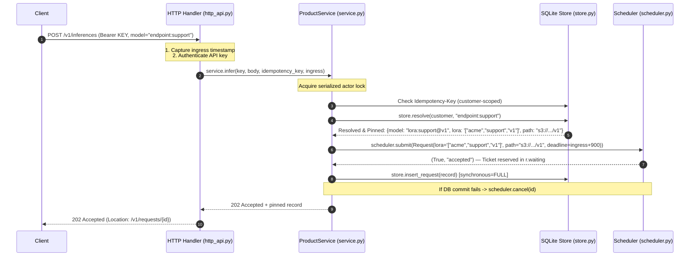
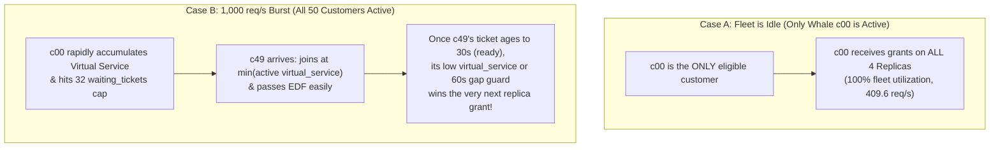
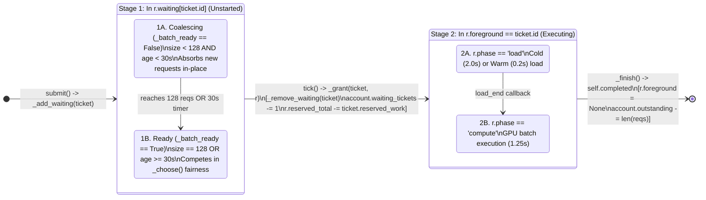
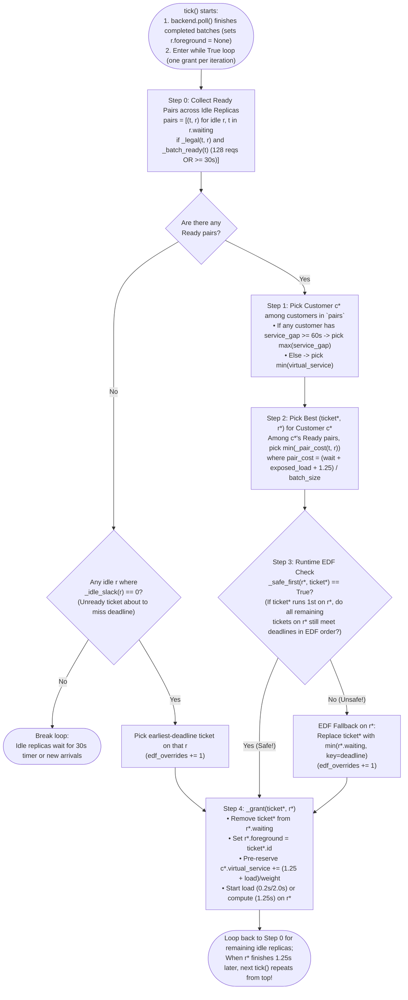
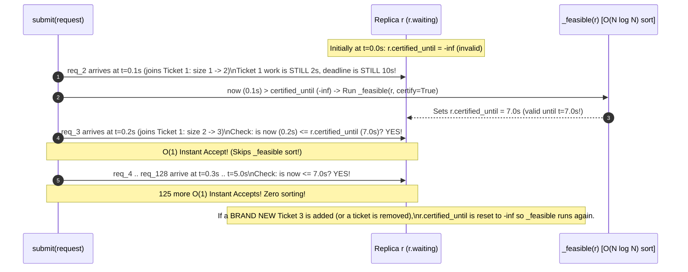
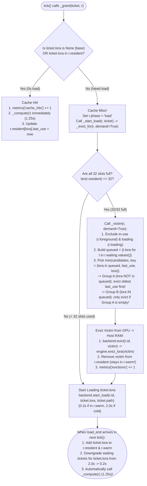
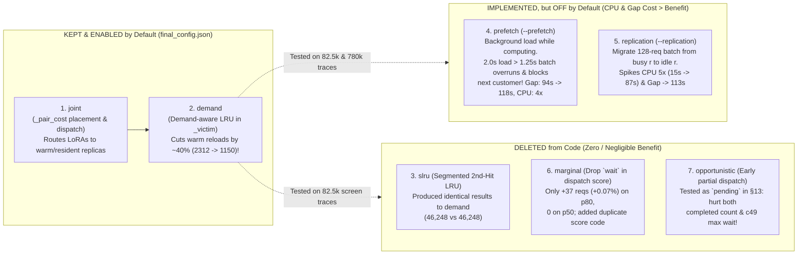
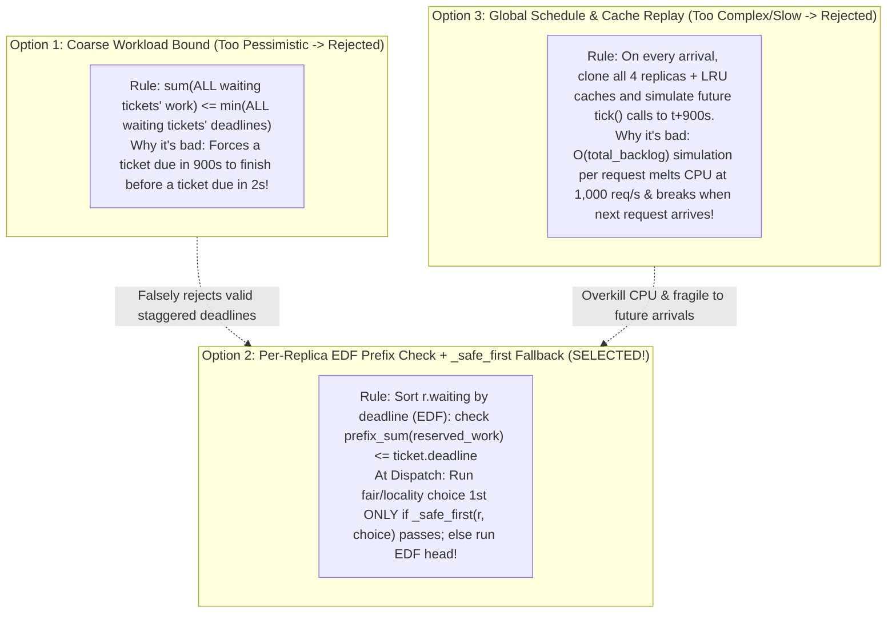

# System Walkthrough Illustrations

## 1. Request Ingress & Immutable Version Pinning

### End-to-End Ingress Flow



### How Version Pinning Survives a Live Upgrade (`v1` → `v2`)

```mermaid
flowchart TB
    subgraph Registry["SQLite Mutable Route vs. Immutable Versions"]
        V1["versions table:\n(acme, support, v1) -> s3://.../v1"]
        V2["versions table:\n(acme, support, v2) -> s3://.../v2"]
        EP["endpoints table:\nendpoint:support\n(pointer moves v1 -> v2)"]
    end

    subgraph Flight["In-Flight Tickets & Requests (Immutable)"]
        R1["Request 1 (arrived at t=10s)\nPinned at admission:\nmodel = lora:support@v1\nlora = '[\"acme\",\"support\",\"v1\"]'\npath = s3://.../v1"]
        R2["Request 2 (arrived at t=12s, after release)\nPinned at admission:\nmodel = lora:support@v2\nlora = '[\"acme\",\"support\",\"v2\"]'\npath = s3://.../v2"]
    end

    V1 -. "1. Resolved at t=10s" .-> R1
    EP == "At t=11s: release(v2, expected_revision=1)" ==> V2
    V2 -. "2. Resolved at t=12s" .-> R2
```

---

## 2. Handling the Whale Customer (`c00`, 40% Traffic) vs. Small Customer (`c49`, 0.02% Traffic)

### Three-Line Defense Against Whale Monopoly (Admission + Dispatch)

```mermaid
flowchart LR
    subgraph Arrivals["Incoming Traffic (1,000 req/s Burst)"]
        W["Whale c00\n(400 req/s, 10 LoRAs)"]
        S["Small c49\n(~0.05 req/s, 2 LoRAs)"]
    end

    subgraph Defense1["Defense 1: Admission Isolation (submit)"]
        Cap["Per-Customer Ticket Cap\n(waiting_tickets <= 32)\nMax 32 * 128 = 4,096 queued reqs\n(~46s max EDF backlog per customer)"]
        Rej["429 tenant_limit\n(Whale excess shed;\nEDF headroom preserved for c49)"]
    end

    subgraph Defense2["Defense 2 & 3: Customer-First Dispatch (_choose & _grant)"]
        Gate["Readiness Gate\n(Full 128 OR age >= 30s)"]
        Gap{"Any ready customer\nservice_gap >= 60s?"}
        VS["Pick min(virtual_service)\n+ Immediate Reservation on _grant\n+ Rejoin at min(active)"]
        Override["Pick max(service_gap)\n(Starvation Guard Override)"]
    end

    W --> Cap
    Cap -- "waiting_tickets == 32" --> Rej
    Cap -- "waiting_tickets < 32" --> Gate
    S -- "waiting_tickets == 0 (100% admitted!)" --> Gate
    Gate --> Gap
    Gap -- "Yes (e.g., c49 waited 60s)" --> Override
    Gap -- "No" --> VS
```



### Idle Fleet vs. Overloaded Fleet Behavior



---

## 3. Ticket Lifecycle & State Accounting (`r.waiting` vs. `r.foreground`)

**Key Insight:** There is **NO separate customer queue**. Your mental steps "1. parking in customer backlog" and "2. enqueued in `r.waiting`" happen **in the exact same place (`r.waiting`)**!



### What Each Counter Tracks at Every Stage

| Variable | Stage 1: In `r.waiting` (Coalescing OR Ready) | Stage 2: In `r.foreground` (`load` or `compute`) | Stage 3: Completed (`self.completed`) |
| :--- | :---: | :---: | :---: |
| **Where does `ticket` live?** | `r.waiting[tid]` & `self.tickets[tid]` | `r.foreground = tid` & `self.tickets[tid]` | Deleted from `self.tickets`; outcomes in `self.completed` |
| **`account.waiting_tickets`** (Capped at 32) | **Included (`+1`)** | **Excluded (`-1` at `_grant`)** | Excluded |
| **`r.reserved_total`** | **Included (`+ticket.reserved_work`)** | **Excluded (`-ticket.reserved_work` at `_grant`)** | Excluded |
| **`account.unstarted_requests`** | **Included (`+len(requests)`)** | **Excluded (`-len(requests)` at `_grant`)** | Excluded |
| **`account.outstanding`** | **Included (`+len(requests)`)** | **Included (still in-flight!)** | **Excluded (`-len(requests)` at `_finish`)** |

---

## 4. Exact Dispatch Flow in `tick()` (Step-by-Step)

**Important Ordering Note:** We filter for **Ready `(ticket, replica)` pairs FIRST** (Step 0), and then pick the **Customer** only among customers that actually have at least one Ready pair!



---

## 5. How `r.certified_until` Works (O(1) Fast-Path for Batch Coalescing)

### Why Does `r.certified_until` Exist?

Imagine Replica `r` is currently idle (`r.foreground is None`) and has **2 waiting tickets** in `r.waiting` at time `now = 0s` (with `response_margin = 0` for simplicity):
- **Ticket 1 (`tail`):** `reserved_work = 2s`, `deadline = 10s`, currently has `1` request (`req_1`).
- **Ticket 2:** `reserved_work = 3s`, `deadline = 12s`.

```text
Timeline at now = 0s:
|---- Ticket 1 (2s) ----|------ Ticket 2 (3s) ------|                 |
0s                      2s                          5s               10s (T1 deadline)  12s (T2 deadline)
                         \__________________________/                  ^
                          Ticket 1 Slack = 10 - 2 = 8s                 |
                                                     \_________________|____/
                                                      Ticket 2 Slack = 12 - 5 = 7s
```

- What is the **minimum slack** across all tickets on Replica `r`?
  `min_slack = min(8s, 7s) = 7s`.
- That means even if Replica `r` sits completely idle until **`t = 7s`**, both Ticket 1 (finishes at `7 + 2 = 9s <= 10s`) and Ticket 2 (finishes at `9 + 3 = 12s <= 12s`) will **still** meet their deadlines!
- So `_feasible(r, certify=True)` saves:
  ```text
  r.certified_until = 7.0s
  ```

### What Happens When `req_2, req_3, ..., req_128` Coalesce into `Ticket 1`?



---

## 6. On-Demand Demand-Aware LRU Eviction (`_grant` → `_start_load` → `_victim`)

**Key Rule:** We **never** evict during `submit()` (admission). Eviction is **100% lazy (on-demand)**: it only happens inside `_grant(ticket, r)` when a chosen ticket is about to run on Replica `r`, its LoRA is not in `r.resident`, and all 32 GPU slots on `r` are full.



### Visual Example of `_victim(r)` Choosing Who to Evict (32/32 Slots Full)

```text
Replica r's 32 GPU Slots (r.resident):
┌─────────────────────────────────────────────────────────────────────────┐
│ LoRA_A: last_use = 10s,  has ticket in r.waiting? YES (in queued=True)  │ -> Protected!
│ LoRA_B: last_use = 50s,  has ticket in r.waiting? NO  (in queued=False) │ -> Evicted 1st! (No queued demand, oldest)
│ LoRA_C: last_use = 80s,  has ticket in r.waiting? NO  (in queued=False) │ -> Kept (newer than B)
│ LoRA_D: currently loading / running in r.foreground                     │ -> Excluded! (Never legal to evict)
└─────────────────────────────────────────────────────────────────────────┘
Result: Plain LRU would have mistakenly evicted LoRA_A (last_use=10s) even though a ticket in r.waiting
is about to use it! Demand-aware LRU evicts LoRA_B instead, saving a 0.2s warm reload!
```

---

## 7. Incremental Locality Mechanisms (`joint`, `demand`, `slru`, `prefetch`, `replication`, `marginal`, `opportunistic`)

We tested 7 incremental mechanisms on top of `Fair` (by adding one mechanism at a time in `iteration-report.md` §3 & §4) and used data to decide **what to keep in `final_config.json`, what to keep as OFF flags, and what to delete**:



### Plain-English Dictionary of All 7 Mechanisms

| Name in Report | What It Actually Does | Measured Result & Why We Kept / Dropped It |
| :--- | :--- | :--- |
| **1. `joint`** | Uses `_pair_cost = (wait + exposed_load + 1.25) / size` at both Admission (`submit`) and Dispatch (`_choose`). | **KEPT (ON):** Establishes sticky cache affinity across the 4 replicas. |
| **2. `demand`** | In `_victim()`, prefers evicting resident LoRAs that have **no waiting tickets** in `r.waiting` (`lora not in queued`). | **KEPT (ON):** Huge win on 780k full traces—**cuts warm reloads in half (`2,312 -> 1,150`)** and adds `+7,714` completions with almost zero CPU cost (`11s -> 15s`). |
| **3. `slru`** | *Segmented / Second-Hit LRU:* protects LoRAs that have been used $\ge 2$ times from being evicted by 1-hit wonders. | **DELETED:** Produced the **exact same** completions (`46,248 / 44,441`) as `demand` because `demand` already protects active adapters! Removed to keep code simple. |
| **4. `prefetch`** | While replica `r` is computing a `1.25s` batch, use `r.loading` to background-load the LoRA for one of the next 2 tickets in `r.waiting` (and pin it for 30s). | **OFF BY DEFAULT (`prefetch: false`):** Because a cold load (`2.0s`) is longer than a compute batch (`1.25s`), when the batch finishes at `1.25s`, the loader is still busy for `0.75s`—blocking the next starving customer! Pushed `p50` max gap from `94.6s` to **`118.4s`** and CPU from `15.5s` to **`64.0s`**. |
| **5. `replication`** | If replica `target` is idle and replica `source` is busy with a full 128-request ticket waiting behind a long queue (`saved_wait > load_cost + 0.2s`), migrate (`migrate()`) that ticket to `target`. | **OFF BY DEFAULT (`replication: false`):** Re-checking both replicas' EDF ledgers on every `tick()` spiked Scheduler CPU from `15.5s` to **`87.7s`** and pushed `p50` gap to **`113.4s`** for only ~1.3% more completions. |
| **6. `marginal`** | Uses `_pair_cost` (with `wait`) at Admission, but drops `wait` at Dispatch (`(exposed_load + 1.25) / size`). | **DELETED:** Added only `+37` requests (`+0.07%`) on `p80` and `+0` on `p50`. Not worth maintaining two separate scoring formulas. |
| **7. `opportunistic`** *(later tested as `eligibility="pending"`)* | Lets an idle replica immediately run an unready (`<30s`, `<128`) partial ticket instead of waiting for `MAX_BATCH_WAIT = 30s`. | **OFF BY DEFAULT (`eligibility: "ready"`):** Locking up a non-preemptible replica for `1.25s–3.25s` on a 1-request ticket reduced total completions (`186.2k -> 183.5k`) and worsened `c49` max wait (`80.4s -> 124.5s`). |

---

## 8. Admission Control Design Options (`docs/design.md` §4)

How do we prove at admission (`submit`) that accepting a new request will not cause any accepted request to miss its `900s` deadline? We compared **3 options**:



### Concrete Numerical Example: Why Option 2 (Per-Replica EDF) Beats Option 1 (Coarse Bound)

Suppose Replica `r` is idle at `now = 0s` (`margins = 0`) and has two warm tickets (`reserved_work = 1.45s` each):
- **Ticket A:** `reserved_work = 1.45s`, `deadline = 2.0s` (urgent!).
- **Ticket B:** `reserved_work = 1.45s`, `deadline = 10.0s` (plenty of time!).

```text
1. Option 1 (Coarse Workload Bound):
   Checks if total work (1.45 + 1.45 = 2.90s) <= earliest deadline (2.0s):
   2.90s <= 2.0s  --->  FALSE! (Falsely REJECTS Ticket B, even though Ticket B isn't due until 10.0s!)

2. Option 2 (Our Per-Replica EDF Prefix Check, _feasible):
   Sorts by deadline [Ticket A, Ticket B] and checks each prefix against its OWN deadline:
   • Prefix 1 (Ticket A): 1.45s <= 2.0s   (PASS!)
   • Prefix 2 (Ticket A + B): 2.90s <= 10.0s  (PASS!)
   ---> ACCEPTS BOTH! And at runtime, _safe_first(r, Ticket B) sees running B first would finish A at 2.90s > 2.0s,
        so it automatically runs Ticket A first (at 1.45s <= 2.0s) and Ticket B second (at 2.90s <= 10.0s)!
```
